<div align="center">

<h1>anokiX Distributor — iOS</h1>

**The wholesale supply side of the anokiX B2B commerce platform, built natively for iOS.**

List products, manage warehouse stock and stores, onboard traders, fulfil and deliver orders,
run promotions and settle finances — from an iPhone or iPad.

[](#)
[](#)
[](#)
[](#)
[](#)
[](LICENSE)

<br>

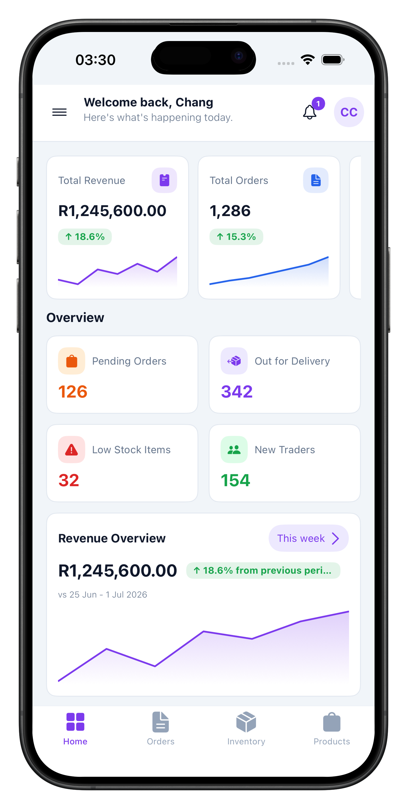
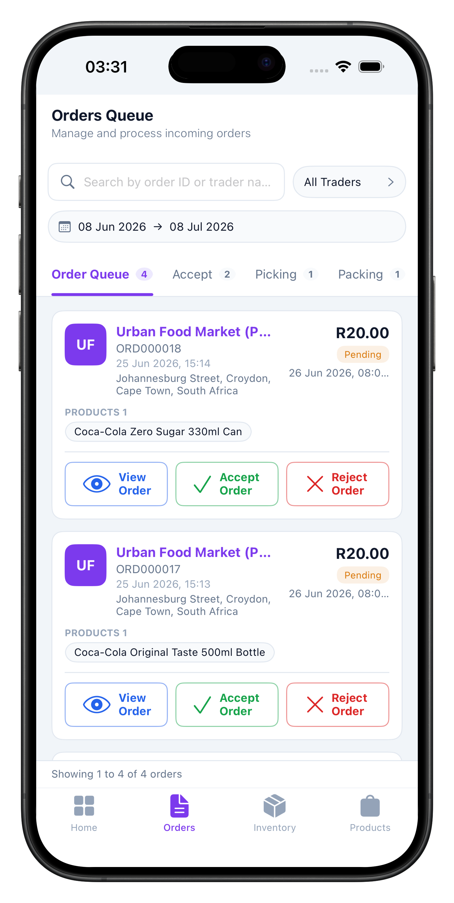
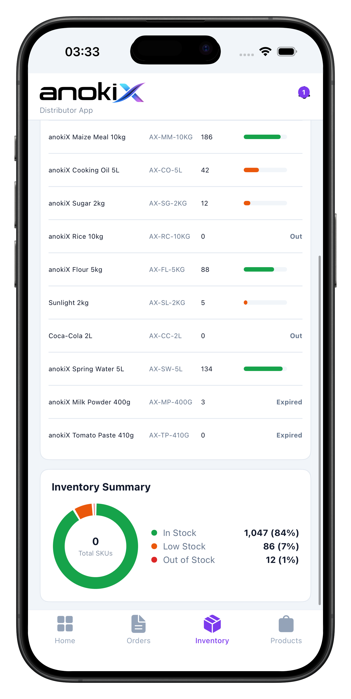
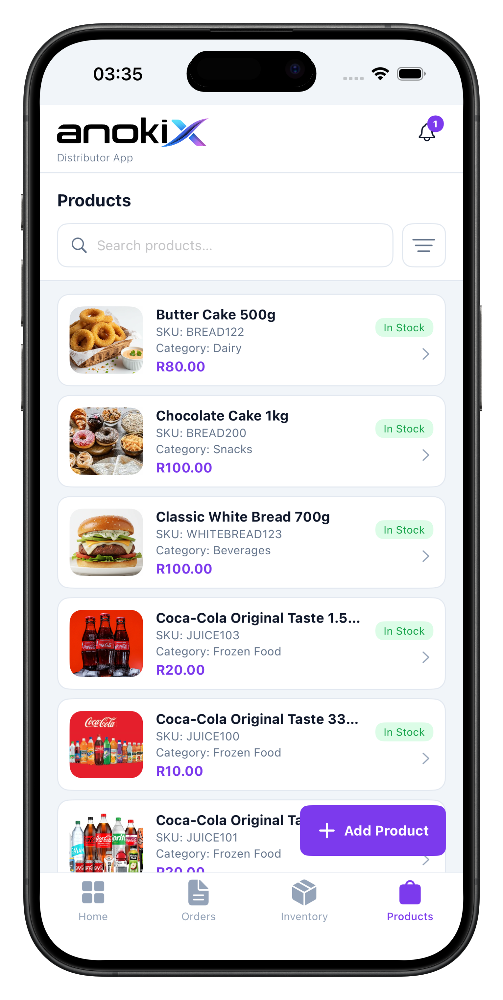

</div>

---

## About

anokiX connects **distributors** (wholesale suppliers) with **traders** (retail shops). This is the distributor's app — a wholesaler's control room showing what's selling, what's in stock, which orders need picking and which traders are buying.

It is a native **UIKit** port of the Android Distributor app: same bundle id (`com.anokix.distributorapp`), same backend, same screens, data models and visual design system.

> [!NOTE]
> **The backend API is currently offline.** This repository is published as a reference for the app's **UI and user flows** — every screenshot below is a real capture from the running app, served by the bundled mock repository. To run against live data, point it at your own backend and supply your own keys (see [Configuration](#configuration)).

---

## Screens and flows

### Sign in and get oriented

A dark navy splash leads to a login sheet with email or phone tabs. The dashboard opens on revenue and order KPIs, then an overview grid — pending orders, out for delivery, low stock, new traders — a revenue chart, a top-selling-category donut and recent orders. A drawer mirrors the portal sidebar and reaches every secondary module.

<table>
<tr>
<td>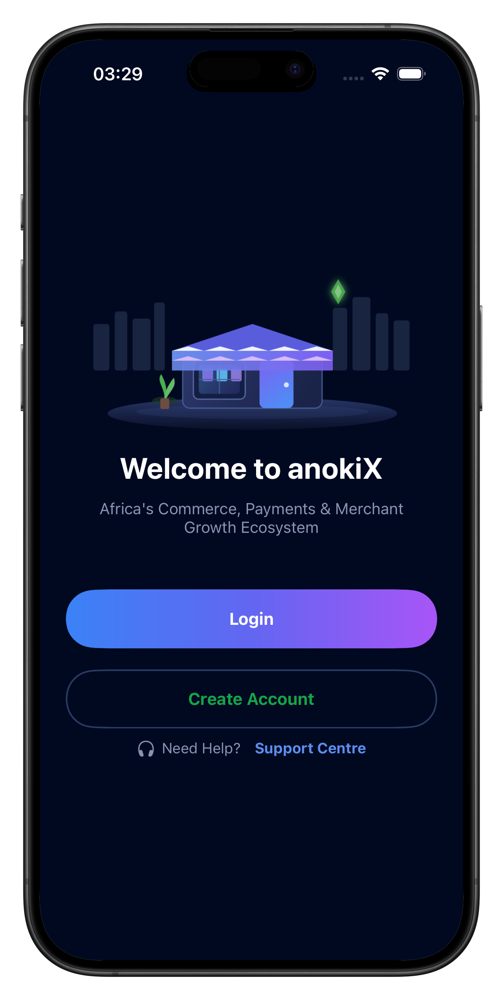</td>
<td>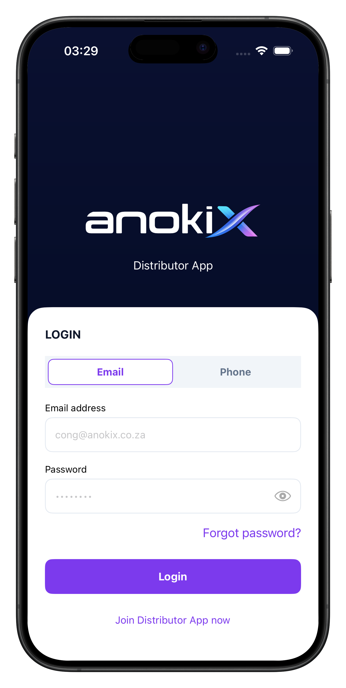</td>
<td></td>
<td>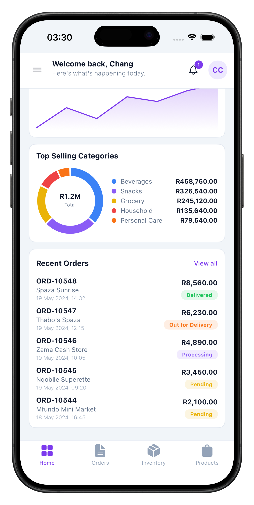</td>
<td>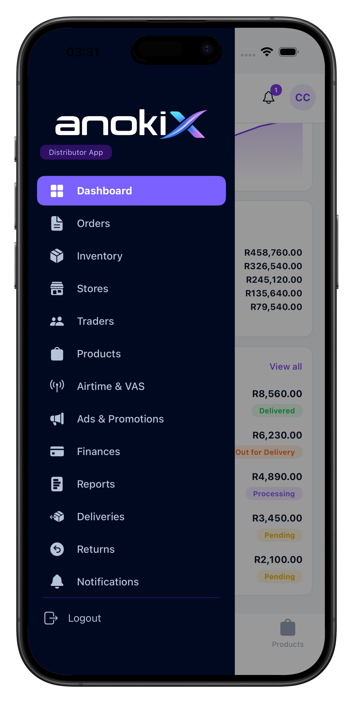</td>
</tr>
<tr>
<td align="center"><sub>Splash</sub></td>
<td align="center"><sub>Login</sub></td>
<td align="center"><sub>Dashboard</sub></td>
<td align="center"><sub>Categories &amp; orders</sub></td>
<td align="center"><sub>Drawer</sub></td>
</tr>
</table>

### Order fulfilment

Orders land in a queue tabbed by stage — **Order Queue → Accept → Picking → Packing → Ready for Delivery → Out for Delivery**. Each card carries its actions inline (*Accept* / *Reject*, later *Mark Ready*), so a warehouse clerk advances an order without opening it. The detail screen shows a live tracking timeline, the trader and the line items.

<table>
<tr>
<td></td>
<td>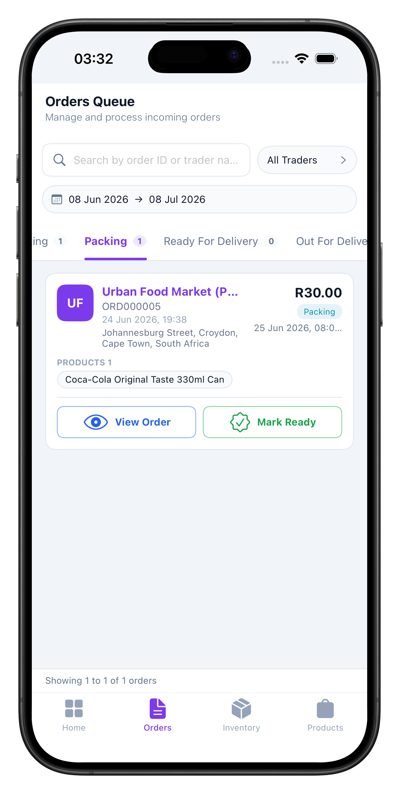</td>
<td>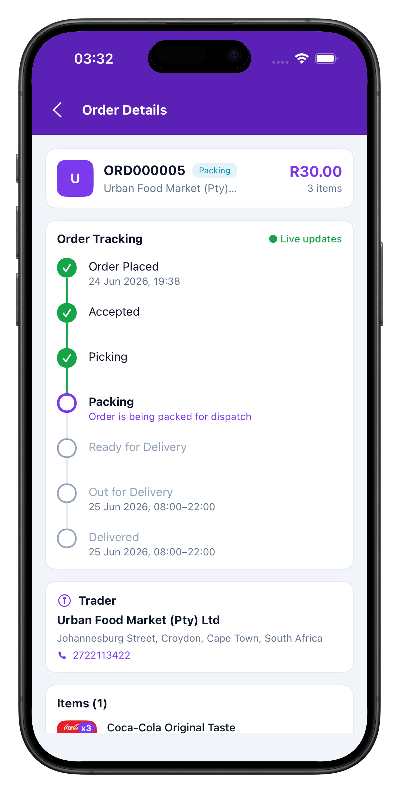</td>
<td>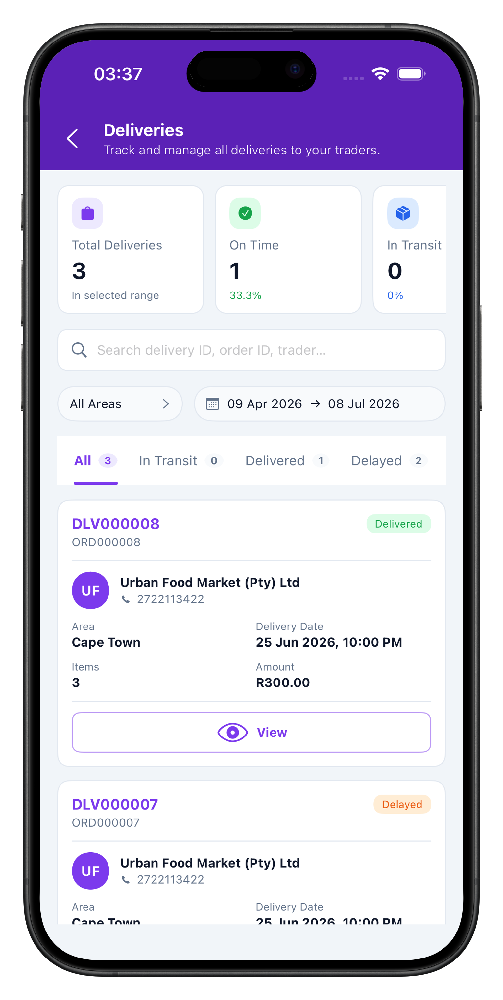</td>
<td>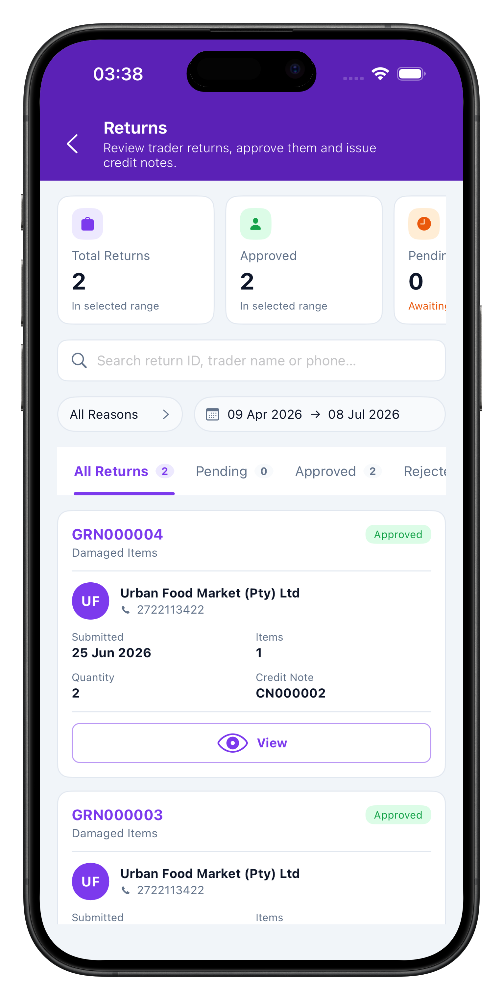</td>
</tr>
<tr>
<td align="center"><sub>Order queue</sub></td>
<td align="center"><sub>Packing stage</sub></td>
<td align="center"><sub>Tracking timeline</sub></td>
<td align="center"><sub>Deliveries</sub></td>
<td align="center"><sub>Returns &amp; credit notes</sub></td>
</tr>
</table>

### Catalogue, stock and stores

Products carry SKU, category, price and a stock badge. Inventory shows per-SKU levels with colour-coded fill bars over an in-stock / low / out donut. Stores are created through a two-step form with fulfilment options (Click &amp; Collect, Click &amp; Deliver) and a Google Maps pin for the address.

<table>
<tr>
<td></td>
<td></td>
<td>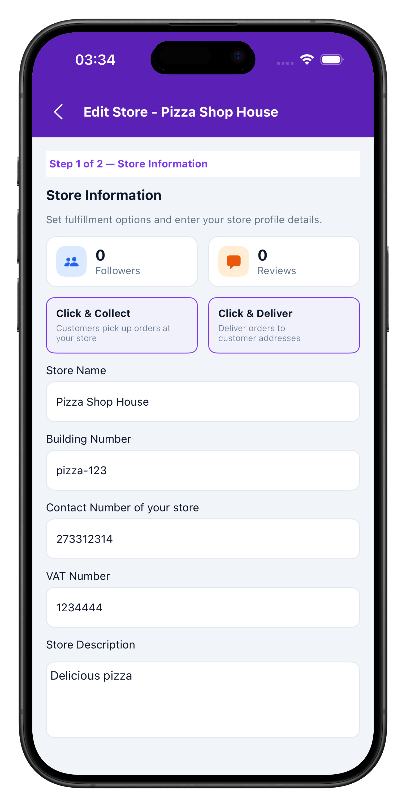</td>
<td>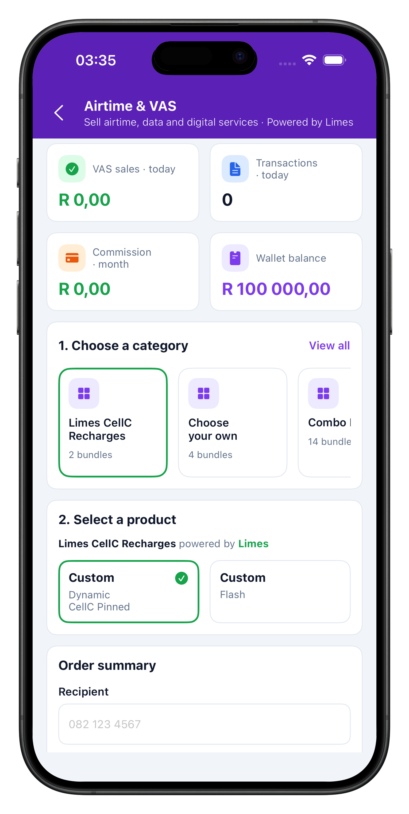</td>
<td>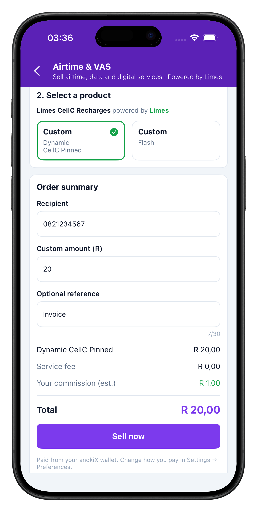</td>
</tr>
<tr>
<td align="center"><sub>Products</sub></td>
<td align="center"><sub>Inventory</sub></td>
<td align="center"><sub>Store form</sub></td>
<td align="center"><sub>Airtime &amp; VAS</sub></td>
<td align="center"><sub>Sell airtime</sub></td>
</tr>
</table>

### Promotions, money and reporting

Campaigns track budget, reach, clicks and CTR, and drill into a summary with targeting, added products and stock allocation logs. Finances splits income from expenses across a transaction ledger. Reports generates and downloads sales, inventory, trader and finance exports.

<table>
<tr>
<td>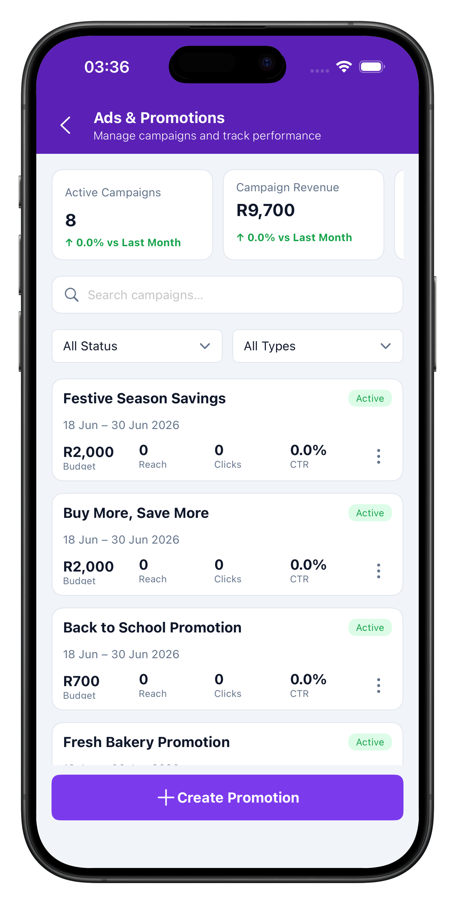</td>
<td>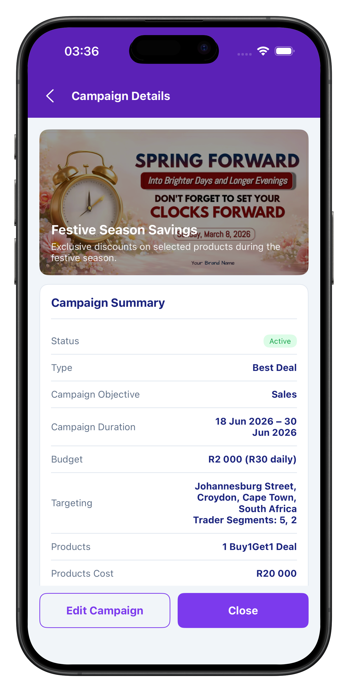</td>
<td>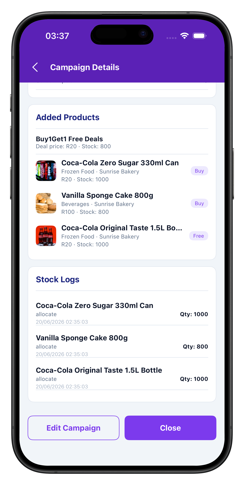</td>
<td>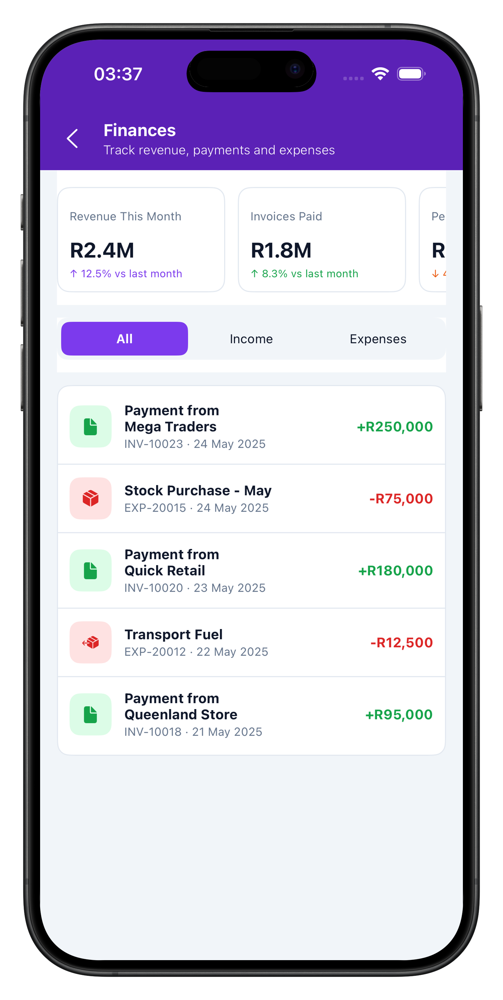</td>
<td>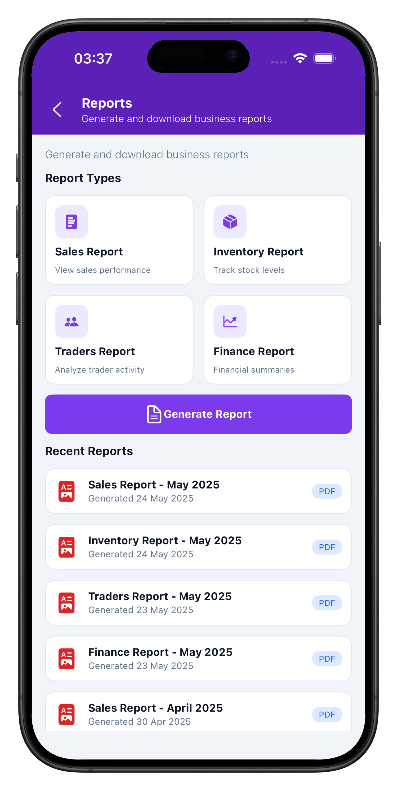</td>
</tr>
<tr>
<td align="center"><sub>Campaigns</sub></td>
<td align="center"><sub>Campaign detail</sub></td>
<td align="center"><sub>Added products</sub></td>
<td align="center"><sub>Finances</sub></td>
<td align="center"><sub>Reports</sub></td>
</tr>
</table>

<details>
<summary><b>All 21 screens</b></summary>

<br>

<table>
<tr>
<td></td>
<td></td>
<td></td>
<td></td>
<td></td>
<td></td>
</tr>
<tr>
<td align="center"><sub>Splash</sub></td><td align="center"><sub>Login</sub></td><td align="center"><sub>Dashboard</sub></td><td align="center"><sub>Categories</sub></td><td align="center"><sub>Drawer</sub></td><td align="center"><sub>Orders</sub></td>
</tr>
<tr>
<td></td>
<td></td>
<td></td>
<td></td>
<td></td>
<td></td>
</tr>
<tr>
<td align="center"><sub>Order detail</sub></td><td align="center"><sub>Packing</sub></td><td align="center"><sub>Inventory</sub></td><td align="center"><sub>Store form</sub></td><td align="center"><sub>Products</sub></td><td align="center"><sub>Airtime</sub></td>
</tr>
<tr>
<td></td>
<td></td>
<td></td>
<td></td>
<td></td>
<td></td>
</tr>
<tr>
<td align="center"><sub>Sell airtime</sub></td><td align="center"><sub>Promotions</sub></td><td align="center"><sub>Campaign</sub></td><td align="center"><sub>Campaign items</sub></td><td align="center"><sub>Finances</sub></td><td align="center"><sub>Reports</sub></td>
</tr>
<tr>
<td>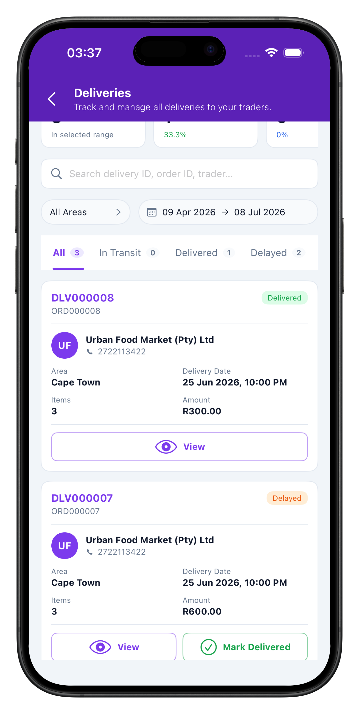</td>
<td></td>
<td></td>
<td></td><td></td><td></td>
</tr>
<tr>
<td align="center"><sub>Deliveries</sub></td><td align="center"><sub>Delivery stats</sub></td><td align="center"><sub>Returns</sub></td><td></td><td></td><td></td>
</tr>
</table>

</details>

---

## Features

| Area | Capability |
| --- | --- |
| **Dashboard** | Revenue and order KPIs, sparklines, category donut, recent orders, wallet detail |
| **Catalogue** | Create and edit products, media upload, category and pricing management |
| **Inventory** | Per-store stock levels, set-stock, transfers, goods receipt, stock-movement history |
| **Stores** | Multi-warehouse management with a Google Maps pin picker |
| **Traders** | Onboard retail customers, review applications, view trader detail |
| **Orders** | Accept, reject, pick, pack and dispatch incoming orders |
| **Deliveries** | Scheduling, per-delivery detail, mark-delivered |
| **Returns** | Goods-return (GRN) approval flow with credit notes |
| **Promotions** | Build campaigns over selected products, with media and stock allocation |
| **Finances &amp; Wallet** | Transaction ledger, income vs expenses, balance, top-up |
| **Card Machine** | POS terminal registry and payment reconciliation |
| **Airtime / VAS** | Customer onboarding, catalogue, subscriptions, transaction history |
| **Reports** | Generate and download server-rendered CSV reports |
| **Staff** | Warehouse staff accounts with their own sign-in |
| **Settings &amp; Support** | Profile, business, security and notification settings; ticketed support |
| **Push** | Firebase Cloud Messaging, token registered on login and removed on logout |

---

## Tech stack

- **Swift**, **UIKit**, iOS 16.0+, universal (iPhone + iPad)
- Project generated by **XcodeGen** from `project.yml` — adding a source file needs no `.pbxproj` edit
- Dependencies via **CocoaPods**:

  | Pod | Purpose |
  | --- | --- |
  | **Alamofire** ~> 5.9 | HTTP transport (`Network/Http.swift`) |
  | **SwiftyJSON** ~> 5.0 | `{ status, message, data }` envelope parsing |
  | **GoogleMaps** ~> 9.0 | Store address pin picker |
  | **Firebase/Messaging** ~> 11.0 | Push notifications |

  Domain models still decode with `Codable`; SwiftyJSON only unwraps the envelope.

### UI approach

**Interface Builder first.** `Main.storyboard` defines Splash, Login and the tab-bar shell. Reusable headers live in XIBs (`DashboardHeaderView`, `LogoHeaderView`, `PageTitleSectionView`). Swift wires actions, API calls and dynamic list content only.

**List rows are XIB templates** — the iOS analogue of Android's per-row `item_*.xml`, so rows are edited visually:

| Android row layout | iOS XIB + cell class |
| --- | --- |
| `item_trader.xml` | `TraderCell.xib` + `TraderCell.swift` |
| `item_product.xml` | `ProductCell.xib` + `ProductCell.swift` |
| `item_store.xml` | `StoreCell.xib` + `StoreCell.swift` |
| `item_inventory.xml` | `InventoryCell.xib` + `InventoryCell.swift` |
| `item_order.xml` | `OrderCell.xib` + `OrderCell.swift` |

Each XIB holds structure, Auto Layout and outlets; `awakeFromNib()` applies fonts, colours and radii from the theme, so Swift stays the single source of truth for styling. A new row XIB is picked up automatically on `xcodegen generate`.

**Adaptive card grids on iPad.** Products, Stores, Traders and Inventory render in a `UICollectionView` driven by `Theme/AdaptiveGridLayout.swift`, a compositional layout whose column count comes from available width — **1 on iPhone, 2 on iPad portrait, 3 on iPad landscape**. The same card XIB is reused at every column count, and spacing lives in the layout rather than the cell, so cards never stretch full-width. It recomputes on rotation and iPad split-view resize.

---

## Getting started

### Prerequisites

- macOS with **Xcode 15** or newer
- `brew install xcodegen cocoapods`

### Generate and run

```bash
xcodegen generate                 # creates AnokiXDistributor.xcodeproj from project.yml
pod install                       # installs pods, creates the .xcworkspace
open AnokiXDistributor.xcworkspace
```

Always open the **`.xcworkspace`**, never the `.xcodeproj`. Set a Development Team under *Signing &amp; Capabilities* the first time you run on a device. Re-run `xcodegen generate && pod install` after adding files or editing the `Podfile`.

<details>
<summary><b>Build error:</b> <code>Pods-AnokiXDistributor-frameworks.sh: Permission denied</code></summary>

<br>

CocoaPods shell scripts lose their executable bit when the repo is checked out on Windows. The `Podfile`'s `post_install` hook restores it and routes embed scripts through `/bin/bash`, so a plain `pod install` usually fixes it. To repair manually:

```bash
chmod +x scripts/fix-pods-permissions.sh && ./scripts/fix-pods-permissions.sh
# or
find "Pods/Target Support Files" -name "*.sh" -exec chmod +x {} \;
```

</details>

### Configuration

No credentials are committed. Supply your own before the app can reach live data:

| What | Where |
| --- | --- |
| API base URL | `ApiClient.baseURL` in `Network/ApiClient.swift` |
| Google Maps API key | `Common/GoogleMapsConfig.swift` |
| Firebase / FCM | `Resources/GoogleService-Info.plist` |
| APNs auth key (`.p8`) | Upload to the Firebase console — **never commit it** |

Create your own Firebase project and Google Cloud API key, enable **Maps SDK for iOS**, and restrict the key to the `com.anokix.distributorapp` bundle ID.

---

## Project structure

```
AnokiXDistributor/
├── App/           AppDelegate, SceneDelegate
├── Common/        AppChrome, Components, Router, pickers, theme helpers
├── Data/          DistributorRepository — API and mock implementations behind one interface
├── Models/        Domain models
├── Network/       ApiClient (typed endpoints) → Http (Alamofire) → DTO/, SessionManager, PushManager
└── Scenes/        One folder per screen — Dashboard, Orders, Inventory, Products, Stores,
                   Traders, Promotions, Deliveries, Returns, Finances, Reports, Wallet,
                   Airtime, CardMachine, Staff, Settings, Support, Login, Register, Main
```

- **Auth** is a bearer token from `api/common/login`, persisted in `UserDefaults` and attached to every later request. Registration can land in a *pending approval* state, rendered as its own screen.
- **Mock repositories** ship alongside the API ones, so every screen can be developed and demoed with no backend — which is how the captures above were produced.
- Every Swift file lives under `AnokiXDistributor/` and is auto-included via the XcodeGen target glob.

---

## Related repositories

| App | Platform |
| --- | --- |
| anokiX Distributor | iOS *(this repo)* · Android |
| anokiX Trader | iOS · Android |

---

## Status

All screens are implemented; the app is at version 1.0.7. The project is authored on Windows and generated with XcodeGen, so a first build on a Mac may surface minor adjustments. The backend API is offline, so the app currently runs against its bundled mock data.

## License

Released under the [MIT License](LICENSE).
